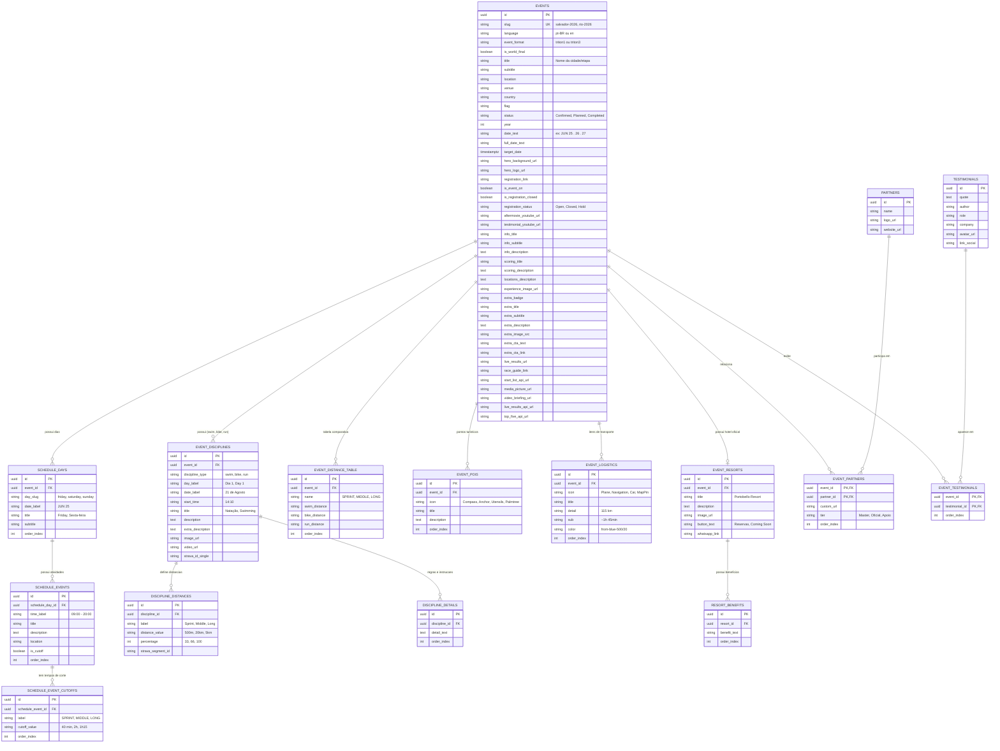

# Modelagem de Banco de Dados Relacional - TRITON World Series

Este documento apresenta a análise profunda do projeto frontend e a arquitetura completa do **Banco de Dados Relacional (PostgreSQL / MySQL)** concebida para substituir o armazenamento estático da variável `EVENT_DATA_MAP` (e `WORLDFINALS_DATA_MAP` de `eventdata.ts`) por um backend dinâmico, escalável e com integridade referencial.

---

## 1. Análise do Projeto Frontend e Diagnóstico

### 1.1 Contexto e Desafios Atuais
Atualmente, o frontend consome os dados do arquivo [`eventdata.ts`](file:///Users/guerlak/Workspace/projetos/triton-web/frontend/eventdata.ts), no qual cada evento é um objeto aninhado de grande porte (`EventData`). Esse formato acopla o código a dados estáticos, dificultando:
1. **Atualizações em tempo real:** Qualquer mudança de horário ou corte exige novo build e deploy.
2. **Duplicação de dados:** Parceiros, hotéis e depoimentos repetem-se entre etapas.
3. **Internacionalização e expansão:** Dificuldade em gerenciar múltiplos idiomas (`pt-BR`, `en`, `es`, `zh`).
4. **Relatórios e consultas cruzadas:** Impossibilidade de filtrar facilmente eventos por ano, país, formato ou status no banco de dados.

### 1.2 Padrões de Uso no Frontend
- **Rotas de Detalhes de Evento:** `/events/triton1/[slug]`, `/events/triton3/[slug]` e `/world-finals/[slug]`. Todas buscam o evento pelo campo único **`slug`**.
- **Páginas de Listagem e Calendário:** Filtram eventos por `year`, `status` ("Confirmed", "Planned", "Completed") e `eventFormat` ("triton1", "triton3").
- **Área de Atletas / Live:** Consomem `isEventOn`, `targetDate` e URLs de APIs externas (`startListApiUrl`, `liveResultsUrl`, `topFiveApiUrl`).
- **Seções da Landing Page de cada Evento:**
  - **Hero:** Imagens de capa e logotipo.
  - **Info & Scoring:** Textos introdutórios e sistema de pontuação.
  - **Formats (Natação, Ciclismo, Corrida):** Dias, horários, descrições, distâncias (Sprint, Middle, Long), rotas Strava e detalhes técnicos.
  - **Schedule:** Agenda dividida por dias (Sexta, Sábado, Domingo), horários, locais e tempos de corte (*cutoffs*).
  - **Locations & Logistics:** Guia turístico (POIs), pontos logísticos (aeroportos/acessos) e hotel oficial (benefícios e links).
  - **Testimonials & AfterMovie:** Vídeos do YouTube e relatos de atletas.
  - **Partners:** Patrocinadores e apoiadores institucionais.
  - **Extra Event:** Eventos paralelos (ex.: Kids & Family).

---

## 2. Diagrama Entidade-Relacionamento (ERD)



---

## 3. Detalhamento e Justificativa de Cada Entidade

### 3.1 `events` (Tabela Central)
- **Papel:** Representa cada etapa do TRITON.
- **Campos Chave:**
  - `slug`: Identificador único para a URL (ex: `salvador-2026`, `rio-2026`, `shijiazhuang-2027`).
  - `event_format`: `triton1` ou `triton3` para renderizar a página e regras específicas de scoring.
  - `is_world_final`: Booleano que unifica a atual `WORLDFINALS_DATA_MAP` dentro da mesma estrutura.
  - `athlete_area` (integrada na tabela ou em tabela 1:1): Mantém os links externos das plataformas de cronometragem (Active, RaceResult).
  - `schedule_important_note`: Aviso legal de alteração de horários.

### 3.2 Modalidades e Percursos (`event_disciplines`, `discipline_distances`, `discipline_details`)
No TypeScript atual, `formats.swim`, `formats.bike` e `formats.run` têm a mesma assinatura:
- Ao normalizar em `event_disciplines` com `discipline_type` (`swim`, `bike`, `run`), eliminamos redundância e permitimos adicionar futuros formatos sem alterar o schema do banco.
- `discipline_distances` armazena as distâncias específicas (Sprint, Middle, Long) e mapeia os `strava_segment_id` específicos de cada distância (como visto no percurso de Ciclismo e Corrida em Salvador/Rio).
- `discipline_details` armazena os tópicos regulamentares (ex.: regras de vácuo, pontos de hidratação).

### 3.3 Tabela Comparativa de Distâncias (`event_distance_table`)
- Mapeia o comparativo exibido na tabela de formato (ex.: SPRINT = 500m Natação / 20km Bike / 5km Corrida).

### 3.4 Agenda e Tempos de Corte (`schedule_days`, `schedule_events`, `schedule_event_cutoffs`)
- **Hierarquia 1:N:** `events` ➔ `schedule_days` (ex.: Friday) ➔ `schedule_events` (ex.: Entrega de Kits, Largada, Cutoff).
- Quando `is_cutoff = true`, os detalhes de tempo por distância (Sprint: 40 min, Middle: 80 min, Long: 120 min) ficam na tabela-filha `schedule_event_cutoffs`, garantindo atomicidade relacional.

### 3.5 Turismo, Logística e Hotelaria (`event_pois`, `event_logistics`, `event_resorts`, `resort_benefits`)
- `event_pois`: Ícones Lucide (`Compass`, `Anchor`, `Utensils`, `Palmtree`) e descrição para o componente `LocationsSection`.
- `event_logistics`: Aeroportos, rodovias e tempos estimados de traslado com gradientes visuais.
- `event_resorts` e `resort_benefits`: O hotel oficial da prova e sua lista dinâmica de vantagens para atletas.

### 3.6 Parceiros e Depoimentos (`partners`, `event_partners`, `testimonials`, `event_testimonials`)
- **Relação N:N (Muitos-para-Muitos):** Patrocinadores como *Prouder* ou *Dobro* apoiam múltiplas etapas. Ter uma tabela `partners` desacoplada permite alterar um logotipo em um único lugar e refletir em todos os eventos. O mesmo vale para atletas ilustres em `testimonials`.

---

## 4. Script DDL Completo em SQL (PostgreSQL)

> *Nota de compatibilidade:* Para MySQL 8+, basta substituir `UUID` por `CHAR(36)` ou `VARCHAR(36)`, e `TIMESTAMPTZ` por `DATETIME`.

```sql
-- Habilita extensão para geração de UUID no PostgreSQL
CREATE EXTENSION IF NOT EXISTS "uuid-ossp";

-- ========================================================
-- 1. TABELA PRINCIPAL DE EVENTOS
-- ========================================================
CREATE TABLE events (
    id UUID PRIMARY KEY DEFAULT uuid_generate_v4(),
    slug VARCHAR(100) NOT NULL UNIQUE,
    language VARCHAR(10) NOT NULL DEFAULT 'pt-BR',
    event_format VARCHAR(20) NOT NULL CHECK (event_format IN ('triton1', 'triton3')),
    is_world_final BOOLEAN NOT NULL DEFAULT FALSE,
    title VARCHAR(150) NOT NULL,
    subtitle VARCHAR(150),
    location VARCHAR(200) NOT NULL,
    venue VARCHAR(200),
    country VARCHAR(100) NOT NULL,
    flag VARCHAR(10),
    status VARCHAR(30) NOT NULL DEFAULT 'Planned' CHECK (status IN ('Confirmed', 'Planned', 'Completed')),
    year INT NOT NULL,
    date_text VARCHAR(100) NOT NULL,
    full_date_text VARCHAR(150),
    target_date TIMESTAMPTZ NOT NULL,
    
    -- Inscrições & Status
    registration_link TEXT,
    is_event_on BOOLEAN NOT NULL DEFAULT FALSE,
    is_registration_closed BOOLEAN NOT NULL DEFAULT FALSE,
    registration_status VARCHAR(20) DEFAULT 'Open' CHECK (registration_status IN ('Open', 'Closed', 'Hold')),
    
    -- Mídia Hero
    hero_background_url TEXT NOT NULL,
    hero_logo_url TEXT NOT NULL,
    
    -- Seção Informativa & Scoring
    info_title VARCHAR(200),
    info_subtitle VARCHAR(200),
    info_description TEXT,
    scoring_title VARCHAR(200),
    scoring_description TEXT,
    
    -- Seção de Localização & Mídia
    locations_description TEXT,
    experience_image_url TEXT,
    
    -- Schedule & Avisos
    schedule_title VARCHAR(100) DEFAULT 'AGENDA',
    schedule_subtitle VARCHAR(150) DEFAULT 'Planning your journey',
    schedule_important_note TEXT,
    
    -- Formats Config
    disable_mix_match BOOLEAN NOT NULL DEFAULT FALSE,
    
    -- Área do Atleta e APIs Externas (Active / RaceResult)
    live_results_url TEXT,
    race_guide_link TEXT,
    start_list_api_url TEXT,
    media_picture_url TEXT,
    video_briefing_url TEXT,
    live_results_api_url TEXT,
    top_five_api_url TEXT,
    
    -- Mídia de Encerramento (Aftermovie e Depoimentos)
    aftermovie_youtube_url TEXT,
    testimonial_youtube_url TEXT,
    
    -- Extra Event (Ex: Triton Kids & Family)
    extra_badge VARCHAR(100),
    extra_title VARCHAR(200),
    extra_subtitle VARCHAR(200),
    extra_description TEXT,
    extra_image_src TEXT,
    extra_image_alt VARCHAR(150),
    extra_cta_text VARCHAR(100),
    extra_cta_link TEXT,
    
    created_at TIMESTAMPTZ NOT NULL DEFAULT CURRENT_TIMESTAMP,
    updated_at TIMESTAMPTZ NOT NULL DEFAULT CURRENT_TIMESTAMP
);

CREATE INDEX idx_events_slug ON events(slug);
CREATE INDEX idx_events_year_status ON events(year, status);
CREATE INDEX idx_events_format ON events(event_format);

-- ========================================================
-- 2. DISCIPLINAS DO FORMATO (SWIM, BIKE, RUN)
-- ========================================================
CREATE TABLE event_disciplines (
    id UUID PRIMARY KEY DEFAULT uuid_generate_v4(),
    event_id UUID NOT NULL REFERENCES events(id) ON DELETE CASCADE,
    discipline_type VARCHAR(10) NOT NULL CHECK (discipline_type IN ('swim', 'bike', 'run')),
    day_label VARCHAR(50),
    date_label VARCHAR(100),
    start_time VARCHAR(20),
    title VARCHAR(100) NOT NULL,
    description TEXT NOT NULL,
    extra_description TEXT,
    image_url TEXT,
    video_url TEXT,
    strava_id_single VARCHAR(100),
    created_at TIMESTAMPTZ NOT NULL DEFAULT CURRENT_TIMESTAMP,
    UNIQUE(event_id, discipline_type)
);

CREATE INDEX idx_disciplines_event ON event_disciplines(event_id);

-- Distâncias por disciplina (Sprint, Middle, Long)
CREATE TABLE discipline_distances (
    id UUID PRIMARY KEY DEFAULT uuid_generate_v4(),
    discipline_id UUID NOT NULL REFERENCES event_disciplines(id) ON DELETE CASCADE,
    label VARCHAR(50) NOT NULL,              -- Sprint, Middle, Long
    distance_value VARCHAR(50) NOT NULL,     -- 500m, 20km, 5km
    percentage INT NOT NULL DEFAULT 100,     -- 33, 66, 100
    strava_segment_id VARCHAR(100),          -- ID de segmento no Strava
    order_index INT NOT NULL DEFAULT 0
);

CREATE INDEX idx_dist_discipline ON discipline_distances(discipline_id);

-- Detalhes/Pontos adicionais da disciplina
CREATE TABLE discipline_details (
    id UUID PRIMARY KEY DEFAULT uuid_generate_v4(),
    discipline_id UUID NOT NULL REFERENCES event_disciplines(id) ON DELETE CASCADE,
    detail_text TEXT NOT NULL,
    order_index INT NOT NULL DEFAULT 0
);

-- ========================================================
-- 3. TABELA COMPARATIVA DE DISTÂNCIAS DO FORMATO
-- ========================================================
CREATE TABLE event_distance_table (
    id UUID PRIMARY KEY DEFAULT uuid_generate_v4(),
    event_id UUID NOT NULL REFERENCES events(id) ON DELETE CASCADE,
    name VARCHAR(50) NOT NULL,               -- SPRINT, MIDDLE, LONG
    swim_distance VARCHAR(50) NOT NULL,      -- 500m
    bike_distance VARCHAR(50) NOT NULL,      -- 20km
    run_distance VARCHAR(50) NOT NULL,       -- 5km
    order_index INT NOT NULL DEFAULT 0
);

CREATE INDEX idx_dist_table_event ON event_distance_table(event_id);

-- ========================================================
-- 4. PROGRAMAÇÃO E CRONOGRAMA (SCHEDULE)
-- ========================================================
CREATE TABLE schedule_days (
    id UUID PRIMARY KEY DEFAULT uuid_generate_v4(),
    event_id UUID NOT NULL REFERENCES events(id) ON DELETE CASCADE,
    day_slug VARCHAR(50) NOT NULL,           -- friday, saturday, sunday
    date_label VARCHAR(50) NOT NULL,         -- JUN 25, 21 Ago
    title VARCHAR(100) NOT NULL,             -- Friday, Sexta-feira
    subtitle VARCHAR(150),                   -- Registration & Briefing
    order_index INT NOT NULL DEFAULT 0,
    created_at TIMESTAMPTZ NOT NULL DEFAULT CURRENT_TIMESTAMP
);

CREATE INDEX idx_schedule_days_event ON schedule_days(event_id);

CREATE TABLE schedule_events (
    id UUID PRIMARY KEY DEFAULT uuid_generate_v4(),
    schedule_day_id UUID NOT NULL REFERENCES schedule_days(id) ON DELETE CASCADE,
    time_label VARCHAR(50),                  -- 09:00 - 20:00, 15:33
    title VARCHAR(200) NOT NULL,
    description TEXT,
    location VARCHAR(200),
    is_cutoff BOOLEAN NOT NULL DEFAULT FALSE,
    order_index INT NOT NULL DEFAULT 0,
    created_at TIMESTAMPTZ NOT NULL DEFAULT CURRENT_TIMESTAMP
);

CREATE INDEX idx_sched_events_day ON schedule_events(schedule_day_id);

-- Detalhes de corte de tempo (Cutoffs)
CREATE TABLE schedule_event_cutoffs (
    id UUID PRIMARY KEY DEFAULT uuid_generate_v4(),
    schedule_event_id UUID NOT NULL REFERENCES schedule_events(id) ON DELETE CASCADE,
    label VARCHAR(50) NOT NULL,              -- SPRINT, MIDDLE, LONG
    cutoff_value VARCHAR(50) NOT NULL,       -- 40 min, 2h, 1h15
    order_index INT NOT NULL DEFAULT 0
);

-- ========================================================
-- 5. TURISMO, LOGÍSTICA E HOTELARIA
-- ========================================================
-- Pontos de interesse turístico (POIs)
CREATE TABLE event_pois (
    id UUID PRIMARY KEY DEFAULT uuid_generate_v4(),
    event_id UUID NOT NULL REFERENCES events(id) ON DELETE CASCADE,
    icon VARCHAR(50) NOT NULL DEFAULT 'Compass',
    title VARCHAR(150) NOT NULL,
    description TEXT NOT NULL,
    order_index INT NOT NULL DEFAULT 0
);

CREATE INDEX idx_pois_event ON event_pois(event_id);

-- Informações de trânsito e aeroportos
CREATE TABLE event_logistics (
    id UUID PRIMARY KEY DEFAULT uuid_generate_v4(),
    event_id UUID NOT NULL REFERENCES events(id) ON DELETE CASCADE,
    icon VARCHAR(50) NOT NULL DEFAULT 'MapPin',
    title VARCHAR(100) NOT NULL,
    detail VARCHAR(100) NOT NULL,            -- 115 km, BR-101
    sub VARCHAR(100) NOT NULL,               -- ~1h 45min, Fácil Conexão
    color VARCHAR(100) NOT NULL DEFAULT 'from-blue-500/20',
    order_index INT NOT NULL DEFAULT 0
);

CREATE INDEX idx_logistics_event ON event_logistics(event_id);

-- Hotel oficial / Resort
CREATE TABLE event_resorts (
    id UUID PRIMARY KEY DEFAULT uuid_generate_v4(),
    event_id UUID NOT NULL UNIQUE REFERENCES events(id) ON DELETE CASCADE,
    title VARCHAR(150) NOT NULL,
    description TEXT NOT NULL,
    image_url TEXT NOT NULL,
    button_text VARCHAR(100) NOT NULL DEFAULT 'Reservas',
    whatsapp_link TEXT,
    created_at TIMESTAMPTZ NOT NULL DEFAULT CURRENT_TIMESTAMP
);

-- Benefícios do Hotel Oficial
CREATE TABLE resort_benefits (
    id UUID PRIMARY KEY DEFAULT uuid_generate_v4(),
    resort_id UUID NOT NULL REFERENCES event_resorts(id) ON DELETE CASCADE,
    benefit_text VARCHAR(255) NOT NULL,
    order_index INT NOT NULL DEFAULT 0
);

-- ========================================================
-- 6. PARCEIROS E PATROCINADORES (MUITOS-PARA-MUITOS)
-- ========================================================
CREATE TABLE partners (
    id UUID PRIMARY KEY DEFAULT uuid_generate_v4(),
    name VARCHAR(150) NOT NULL UNIQUE,
    logo_url TEXT NOT NULL,
    default_url TEXT,
    created_at TIMESTAMPTZ NOT NULL DEFAULT CURRENT_TIMESTAMP
);

CREATE TABLE event_partners (
    event_id UUID NOT NULL REFERENCES events(id) ON DELETE CASCADE,
    partner_id UUID NOT NULL REFERENCES partners(id) ON DELETE CASCADE,
    custom_url TEXT,
    tier VARCHAR(50) DEFAULT 'Official',
    order_index INT NOT NULL DEFAULT 0,
    PRIMARY KEY (event_id, partner_id)
);

CREATE INDEX idx_event_partners_event ON event_partners(event_id);

-- ========================================================
-- 7. DEPOIMENTOS (MUITOS-PARA-MUITOS)
-- ========================================================
CREATE TABLE testimonials (
    id UUID PRIMARY KEY DEFAULT uuid_generate_v4(),
    author VARCHAR(150) NOT NULL,
    quote TEXT NOT NULL,
    company VARCHAR(100),
    role VARCHAR(100),
    avatar_url TEXT,
    link_social TEXT,
    created_at TIMESTAMPTZ NOT NULL DEFAULT CURRENT_TIMESTAMP
);

CREATE TABLE event_testimonials (
    event_id UUID NOT NULL REFERENCES events(id) ON DELETE CASCADE,
    testimonial_id UUID NOT NULL REFERENCES testimonials(id) ON DELETE CASCADE,
    order_index INT NOT NULL DEFAULT 0,
    PRIMARY KEY (event_id, testimonial_id)
);

CREATE INDEX idx_event_testimonials_event ON event_testimonials(event_id);
```

---

## 5. Como o Backend Reconstrói o Objeto `EventData`

Para manter compatibilidade absoluta com o código TypeScript do frontend (`getEventData(slug)`), o backend pode expor o endpoint:

`GET /api/v1/events/:slug`

### Exemplo de Query com Agregação JSON no PostgreSQL:
```sql
SELECT 
    e.id,
    e.slug,
    e.language,
    e.event_format AS "eventFormat",
    e.is_world_final AS "isWorldFinal",
    e.title,
    e.subtitle,
    e.location,
    e.venue,
    e.country,
    e.flag,
    e.status,
    e.year,
    e.date_text AS "dateText",
    e.full_date_text AS "fullDateText",
    e.target_date AS "targetDate",
    e.registration_link AS "registrationLink",
    e.is_event_on AS "isEventOn",
    e.is_registration_closed AS "isRegistrationClosed",
    e.registration_status AS "registrationStatus",
    
    -- Hero
    json_build_object(
        'backgroundImage', e.hero_background_url,
        'logoImage', e.hero_logo_url
    ) AS hero,
    
    -- Info & Scoring
    json_build_object(
        'title', e.info_title,
        'subtitle', e.info_subtitle,
        'description', e.info_description
    ) AS info,
    json_build_object(
        'title', e.scoring_title,
        'description', e.scoring_description
    ) AS scoring,
    
    -- Athlete Area
    json_build_object(
        'liveResultsUrl', e.live_results_url,
        'raceGuideLink', e.race_guide_link,
        'startListApiUrl', e.start_list_api_url,
        'mediaPictureUrl', e.media_picture_url,
        'videoBriefingUrl', e.video_briefing_url,
        'liveResultsApiUrl', e.live_results_api_url,
        'topFiveApiUrl', e.top_five_api_url
    ) AS "athleteArea",
    
    -- Schedule Days & Events
    json_build_object(
        'title', e.schedule_title,
        'subtitle', e.schedule_subtitle,
        'importantNote', e.schedule_important_note,
        'days', COALESCE((
            SELECT json_agg(
                json_build_object(
                    'id', sd.day_slug,
                    'date', sd.date_label,
                    'title', sd.title,
                    'subtitle', sd.subtitle,
                    'events', COALESCE((
                        SELECT json_agg(
                            json_build_object(
                                'time', se.time_label,
                                'title', se.title,
                                'description', se.description,
                                'location', se.location,
                                'isCutoff', se.is_cutoff,
                                'details', (
                                    SELECT json_agg(
                                        json_build_object(
                                            'label', sec.label,
                                            'value', sec.cutoff_value
                                        ) ORDER BY sec.order_index
                                    )
                                    FROM schedule_event_cutoffs sec
                                    WHERE sec.schedule_event_id = se.id
                                )
                            ) ORDER BY se.order_index
                        )
                        FROM schedule_events se
                        WHERE se.schedule_day_id = sd.id
                    ), '[]'::json)
                ) ORDER BY sd.order_index
            )
            FROM schedule_days sd
            WHERE sd.event_id = e.id
        ), '[]'::json)
    ) AS schedule,

    -- Locations, POIs, Logistics & Resort
    json_build_object(
        'description', e.locations_description,
        'experience', json_build_object(
            'image', e.experience_image_url,
            'pois', COALESCE((
                SELECT json_agg(
                    json_build_object('icon', ep.icon, 'title', ep.title, 'desc', ep.description)
                    ORDER BY ep.order_index
                ) FROM event_pois ep WHERE ep.event_id = e.id
            ), '[]'::json)
        ),
        'logistics', COALESCE((
            SELECT json_agg(
                json_build_object(
                    'icon', el.icon,
                    'title', el.title,
                    'detail', el.detail,
                    'sub', el.sub,
                    'color', el.color
                ) ORDER BY el.order_index
            ) FROM event_logistics el WHERE el.event_id = e.id
        ), '[]'::json),
        'resort', (
            SELECT json_build_object(
                'title', er.title,
                'description', er.description,
                'image', er.image_url,
                'buttonText', er.button_text,
                'whatsappLink', er.whatsapp_link,
                'benefits', COALESCE((
                    SELECT json_agg(rb.benefit_text ORDER BY rb.order_index)
                    FROM resort_benefits rb WHERE rb.resort_id = er.id
                ), '[]'::json)
            ) FROM event_resorts er WHERE er.event_id = e.id
        )
    ) AS locations,

    -- Partners
    COALESCE((
        SELECT json_agg(
            json_build_object(
                'name', p.name,
                'logo', p.logo_url,
                'url', COALESCE(ep.custom_url, p.default_url)
            ) ORDER BY ep.order_index
        )
        FROM event_partners ep
        JOIN partners p ON p.id = ep.partner_id
        WHERE ep.event_id = e.id
    ), '[]'::json) AS partners

FROM events e
WHERE e.slug = 'salvador-2026';
```

---

## 6. Estratégia de Internacionalização (i18n)

No projeto atual, cada chave possui um idioma primário (`language: 'pt-BR' | 'en'`). Para o backend, há duas estratégias recomendadas:

### Opção A: Coluna de Idioma no Evento (Mais simples e compatível com a estrutura atual)
- A tabela `events` armazena o idioma em que a etapa foi cadastrada (`language`).
- Se uma etapa tiver versões separadas em PT e EN (ex.: `salvador-2026-pt` e `salvador-2026-en`), elas compartilham um `group_id` ou código base.

### Opção B: Tabela de Traduções Normalizada (Recomendada para expansão global)
- Cria-se tabelas filhas `event_translations`, `discipline_translations`, etc., com chave composta `(event_id, locale)`.
- Permite que a etapa de Salvador tenha títulos, descrições e avisos em Português, Inglês e Mandarim sem duplicar registros técnicos de distâncias e Strava.

---

## 7. Recomendações de Stack e Migração

1. **ORM Recomendado:** **Prisma** ou **Drizzle ORM** com TypeScript.
   - O schema relacional acima mapeia diretamente para os modelos do Prisma Schema ou tabelas Drizzle com total *type-safety*.
2. **Script de Seed Automático:**
   - Criar um script `seed.ts` no backend que importe o `EVENT_DATA_MAP` de `eventdata.ts` e execute `INSERT`s populando o banco de dados com 100% dos dados atuais sem perda de informação.
3. **Substituição Transparente no Frontend:**
   - Atualizar [`services/EventService.ts`](file:///Users/guerlak/Workspace/projetos/triton-web/frontend/services/EventService.ts):
     ```typescript
     export const getEventData = cache(async (slug: string): Promise<EventData | null> => {
       const res = await fetch(`${process.env.BACKEND_API_URL}/api/v1/events/${slug}`, {
         next: { revalidate: 60 }
       });
       if (!res.ok) return null;
       return res.json();
     });
     ```
   - Nenhuma linha dos componentes visuais (`ScheduleSection`, `FormatsSection`, `LocationsSection`, etc.) precisará ser alterada!

